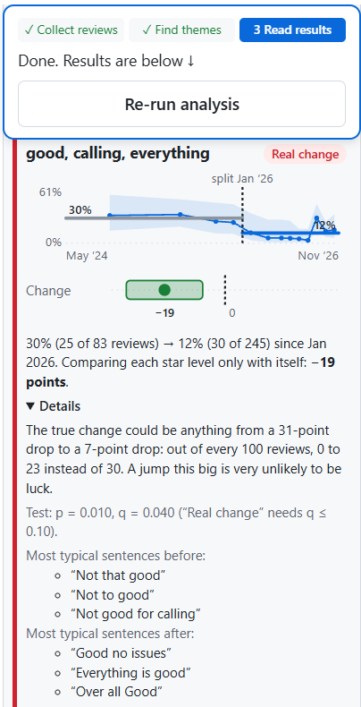
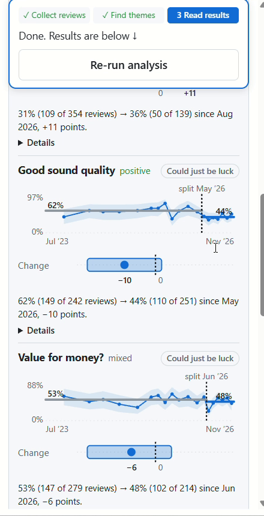
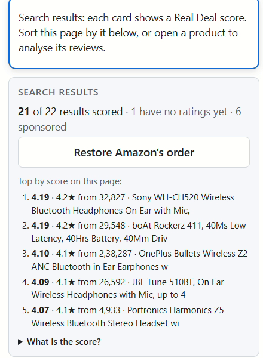
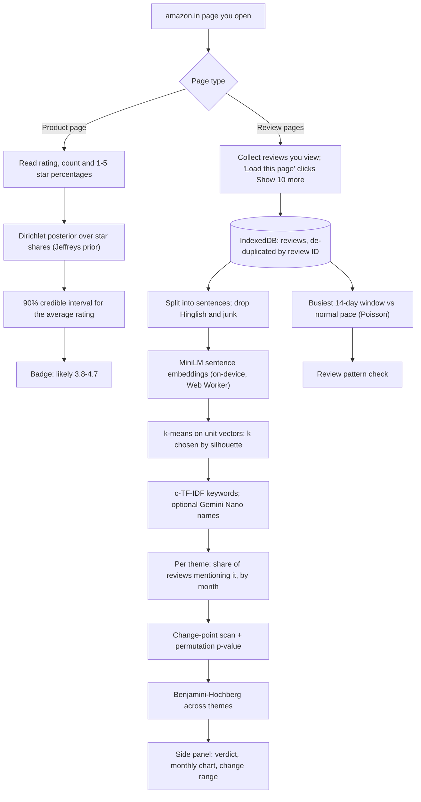

# Real Deal

**How much should you trust an amazon.in product's reviews, and have they changed?**

Real Deal is a Chrome extension that adds honest, uncertainty-aware statistics to amazon.in.
It runs **entirely in your browser**: no server, no account, no network calls.

| What you see | What it tells you |
|---|---|
| **Rating range** next to the stars: `likely 3.8–4.7 · low data` | How sure you can be about the average. 4.4★ from 22 ratings could be 3.8 or 4.7. From 11,000 ratings it is pinned down. |
| **Themes over time** in a side panel | What reviewers talk about ("Missing pieces in the box", "Colour fading after wash") and whether each topic's share of reviews **really changed** or **could just be luck**. |
| **Search results score** | A cautious rating on every search result (4.6★ from 9 ratings ranks below 4.3★ from 2,000), and a switch to sort the current page by it. |
| **Review pattern check** | Unusually busy periods of reviews that were also unusually positive or unverified: *signals* worth reading about, never "fake". |

**Validated on real data.** On 50 products from the McAuley Lab Amazon Reviews 2023 dataset, the method
found a wipes product's packaging change at the right month (June 2021), which reviewers independently
confirmed ("New packaging awful… they took away the plastic flip top cover"). In simulation, its false-alarm
rate is 5% and it detects a 10% → 25% shift 85% of the time with 300 reviews. → [Validation](#validation)

| A **Real change**: short "not good for calling" verdicts fell from 30% to 12% of reviews after Jan 2026 | **Could just be luck**: the box crosses 0 | Search results scored |
|---|---|---|
|  |  |  |

---

## How it works



### Concepts used

| Concept | Question it answers | Method | Code |
|---|---|---|---|
| **Bayesian credible interval** | How sure can we be about the true average rating? | Dirichlet–multinomial posterior, Jeffreys prior α₀ = 0.5, Monte Carlo quantiles | [`stats/rating.ts`](src/stats/rating.ts) |
| **Sentence embeddings** | Which sentences mean the same thing? | all-MiniLM-L6-v2, mean-pooled, L2-normalised, cosine similarity | [`themes/embed.worker.ts`](src/themes/embed.worker.ts) |
| **Clustering** | What are the main topics? | Spherical k-means (k-means++ seeding), k ∈ [3, 8] by mean silhouette | [`themes/cluster.ts`](src/themes/cluster.ts) |
| **Topic labelling** | What is each topic about? | c-TF-IDF (as in BERTopic), plus on-device LLM names verified against keywords | [`themes/ctfidf.ts`](src/themes/ctfidf.ts), [`ai/label.ts`](src/ai/label.ts) |
| **Change-point detection** | Did a topic's share change, and when? | Binomial likelihood-ratio scan over month boundaries | [`stats/changepoint.ts`](src/stats/changepoint.ts) |
| **Permutation test** | Could that change be luck? | Shuffle review order 999×; p = (1 + #{T_b ≥ T}) / (B + 1) | [`stats/changepoint.ts`](src/stats/changepoint.ts) |
| **Stratified test (CMH)** | Is the change real, or caused by which star filters were used? | Cochran–Mantel–Haenszel statistic, shuffles within star levels | [`stats/changepoint.ts`](src/stats/changepoint.ts) |
| **Multiple testing** | With many themes, which changes survive? | Benjamini–Hochberg false-discovery rate, q ≤ 0.10 | [`stats/fdr.ts`](src/stats/fdr.ts) |
| **Confidence intervals** | How big is the change? | Wilson (per month), Newcombe (difference), Agresti–Caffo (star-adjusted) | [`stats/intervals.ts`](src/stats/intervals.ts) |
| **Shrinkage + lower bound** | Which search result's rating can you trust most? | (C·m + N·r̄)/(C+N) − 1.645·σ/√(C+N), constants estimated from data | [`stats/rating.ts`](src/stats/rating.ts), [`content/amazon/search.ts`](src/content/amazon/search.ts) |
| **Burst detection** | Was there an unusual flood of reviews? | Poisson tail of the busiest 14-day window, corrected for windows searched | [`stats/burst.ts`](src/stats/burst.ts) |
| **LLM output validation** | Can the AI summary be trusted? | Every number must appear in the test results; no change claims when none is significant | [`ai/label.ts`](src/ai/label.ts) |

### Key formulas

**1. Rating range.** From the star percentages $p_k$ and rating count $N$, counts are
$c_k = \mathrm{round}(p_k N / 100)$. The true star shares $\theta$ get a Jeffreys prior, and the
posterior is again Dirichlet:

$$\theta \mid c \sim \mathrm{Dirichlet}(0.5 + c_1, \dots, 0.5 + c_5), \qquad \mu = \sum_{k=1}^{5} k\,\theta_k .$$

The badge shows the 5th–95th percentiles of $\mu$ from 4,000 draws. (A uniform prior was tried first. It gave
correct ranges only 74% of the time on 5★-heavy products, against 88–91% for Jeffreys.)

**2. Is a review about the theme?** Each sentence is a unit vector $v$. Similarity is $\cos(u,v) = u\cdot v$.
Clusters come from k-means, and the number of themes $k$ maximises the mean silhouette
$s(i) = \frac{b(i)-a(i)}{\max\{a(i),b(i)\}}$. Review $i$ mentions theme $j$ ($x_i = 1$) if any of its
sentences is in cluster $j$.

**3. Did the share change?** For a split at month boundary $\tau$, with $k_1$ of $n_1$ reviews mentioning the theme
before and $k_2$ of $n_2$ after, and $\ell(k,n) = k\log\frac{k}{n} + (n-k)\log\frac{n-k}{n}$:

$$\mathrm{LR}(\tau) = \ell(k_1,n_1) + \ell(k_2,n_2) - \ell(k_1+k_2,\,n_1+n_2), \qquad T = \max_\tau \mathrm{LR}(\tau).$$

**4. Could it be luck?** Shuffle the $x_i$ across reviews $B = 999$ times and recompute $T$:

$$p = \frac{1 + \#\{b : T_b \ge T\}}{B + 1}.$$

This accounts for having searched every month. When star filters made the sample unrepresentative, the
**Cochran–Mantel–Haenszel** form compares each star level only with itself:
$\mathrm{CMH}(\tau) = \big(\sum_s (O_s - E_s)\big)^2 / \sum_s V_s$.

**5. Many themes at once.** With $m$ p-values sorted $p_{(1)} \le \dots \le p_{(m)}$, the Benjamini–Hochberg
$q$-values are $q_{(i)} = \min_{j \ge i} \frac{m\,p_{(j)}}{j}$. A theme shows **Real change** only if $q \le 0.10$.

**6. How big is the change?** Each month's share has a Wilson interval

$$\frac{\hat p + \frac{z^2}{2n} \pm z\sqrt{\frac{\hat p(1-\hat p)}{n} + \frac{z^2}{4n^2}}}{1 + \frac{z^2}{n}},$$

and the before/after difference a Newcombe interval built from two Wilson intervals.

**7. Unusual burst of reviews.** The busiest 14-day window has $X_{\max}$ reviews. A steady pace expects
$\lambda = 14n/D$ over $D$ days. The check flags the window if

$$p = \min\!\Big(1, \tfrac{D}{14}\, P(X \ge X_{\max} \mid \lambda)\Big) < 0.001, \qquad X \sim \mathrm{Poisson}(\lambda),$$

and also checks whether that window was ≥ 0.5★ more positive or ≥ 20 points more unverified.

Full derivations, worked examples and simulations: **[docs/METHODOLOGY.md](docs/METHODOLOGY.md)**.

---

## Validation

**Simulation** (500 runs per cell, theme share 10% before the change, change in month 7 of 12):

| Share after the change | 100 reviews | 150 | 300 | 600 |
|---|---|---|---|---|
| 10% (no change → false alarms) | 5.4% | 4.4% | 5.6% | 4.6% |
| 20% | 21% | 30% | 58% | 83% |
| 25% | 43% | 53% | **85%** | 99% |
| 30% | 64% | 79% | 97% | 100% |

So "Could just be luck" with about 100 reviews means *not enough data*, not "nothing changed".

**Real data** ([`research/01_changepoint_validation.ipynb`](research/01_changepoint_validation.ipynb),
McAuley Lab Amazon Reviews 2023, All_Beauty, 50 products with years of reviews):

- **A real product change, found at the right time:** a wipes product's "packaging, new, open" theme rose from
  8% to 40% of reviews from June 2021. Reviewers wrote "New packaging awful", the first such complaint on 14 Aug 2021.
- **Other detected changes need reading:** changes in who buys a product (a spray bottle moving from "curly
  hair" to "plant misting"), shifts in review culture (incentivized reviews before Amazon's 2016 ban), and
  listings that cover several products. The panel shows each theme's most typical sentences for that reason.
- **A suspicious review burst:** an eye cream with 109 reviews in 14 days (normal pace: 3), averaging 4.81★ vs
  4.27★ and 99% unverified vs 34%. This is the pattern the Review pattern check looks for.
- **Data-driven constants** for the planned ranking score: prior mean 3.98★, per-review SD 1.34, prior
  weight ≈ 5 ratings.

Every problem met along the way (53 so far), *why* it happened and why it wasn't caught earlier, is
logged in **[docs/DECISIONS.md](docs/DECISIONS.md)**.

---

## Privacy

- **Everything stays on your computer.** Reviews, results and settings are stored only in this browser.
- **On-device AI only.** Sentence meanings come from a 23 MB model bundled in the extension. Optional theme
  names and summaries come from **Gemini Nano**, which runs inside Chrome.
- **Zero network calls, enforced by Chrome.** Extension pages and the worker run under `connect-src 'self'`.
  The content script on amazon.in only reads the page. Verify with `npm run audit:network`.
- **It reads only pages you open.** The one exception, **Load reviews on this page**, clicks Amazon's own "Show
  10 more" every 2–4 s up to Amazon's 100 per view, and only when you press it.

## Install (developer mode)

Needs Node.js 20+ and Chrome.

```bash
git clone https://github.com/Saminay786/real-deal.git
cd real-deal
npm install
npm run fetch-model   # once: downloads the 23 MB model (pinned version, SHA-256 checked)
npm run build         # outputs dist/
```

In Chrome: `chrome://extensions` → **Developer mode** on → **Load unpacked** → choose `dist`.

**Gemini Nano (optional)** gives readable theme names and a written summary. It needs a recent desktop Chrome,
about 22 GB of free disk space, and a GPU with more than 4 GB VRAM or a CPU with 16 GB RAM. Without it, Real Deal
uses keyword labels and a template summary. See Google's
[built-in AI documentation](https://developer.chrome.com/docs/ai/built-in).

## Using it

1. Open a product on amazon.in. The rating range appears next to the stars.
2. Open the side panel (the Real Deal icon). A bar at the top always shows the **one next step**: open the
   reviews → load this page → open the next filter → **Find themes**. Amazon shows at most 100 reviews per
   sort or filter, so Real Deal works through filters and merges them without duplicates.
3. Read each theme's verdict (**Real change**, **Could just be luck** or **Not proven**), its monthly chart, and
   a sentence with the counts, e.g. "5% (3 of 60 reviews) → 13% (6 of 45) since Mar 2025".

## Limitations

- Only reviews you viewed are analysed, and Amazon chooses which ones it shows (100 per sort/filter).
- "Could just be luck" means not enough reviews to tell. About 100 reviews detect only large shifts.
- Failures after months of use can rise as units age, even if the product sold today is the same.
- A theme can merge related topics; check its typical sentences.
- Hindi and Hinglish reviews are skipped (the model is English-only). Reviewers are not all buyers.
- amazon.in only. Amazon's page layout changes, so selectors may need updating.

## Related work

- **Amazon "Customers say"**: an AI review summary, with no time dimension and no uncertainty.
- **Fakespot** (shut down in 2025) and **ReviewMeta**: server-side authenticity grading. Real Deal runs locally
  and reports *signals*, not verdicts.
- **Keepa / camelcamelcamel**: price history, not reviews.
- **BERTopic** (Grootendorst, 2022): origin of c-TF-IDF. Real Deal adds per-theme change-point tests with
  false-discovery control, on-device.

## Roadmap

- **v3:** a multilingual model for Hindi/Hinglish; splitting merged themes; Flipkart.

## Project layout

```
src/content/     reads amazon.in pages (selectors in one file), badge, review collection
src/collect/     IndexedDB store, collection progress, filter "views"
src/themes/      sentences, embeddings worker, clustering, c-TF-IDF, analysis
src/stats/       pure statistics: rating, buckets, intervals, change point, FDR, bursts
src/ai/          Gemini Nano labels and summary, with validation and fallbacks
src/sidepanel/   Preact UI
research/        Python notebook validating the method on Amazon Reviews 2023
docs/            METHODOLOGY.md (formulas), DECISIONS.md (what went wrong and why)
```

## Development

```bash
npm test               # ~200 unit tests incl. simulations (Vitest)
npm run build          # type-check + production build
npm run audit:network  # verify the build cannot make outbound requests
```

Specification and contributor rules: [CLAUDE.md](CLAUDE.md).

## License

[MIT](LICENSE) © 2026 Saminay786
