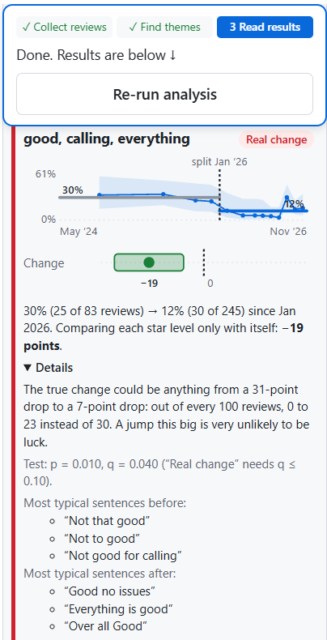
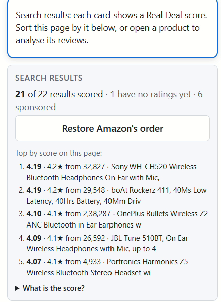

# Real Deal: user guide

Real Deal is a free Chrome extension for **amazon.in**. It shows how much you can trust a product's star rating,
and whether what reviewers talk about **changed over time**. Everything runs on your computer: no account, no
servers, nothing sent anywhere.

**Contents:** [Install](#1-install-5-minutes) · [Product pages](#2-on-a-product-page) ·
[Themes over time](#3-themes-over-time-the-side-panel) · [Reading the results](#4-reading-the-results) ·
[Search pages](#5-on-a-search-page) · [Settings](#6-settings) · [Update or remove](#7-update-or-remove) ·
[Troubleshooting](#8-troubleshooting)

---

## 1. Install (5 minutes)

Real Deal isn't on the Chrome Web Store, so you install it from a download. You need **Google Chrome** on a
computer (Windows, Mac or Linux). It doesn't work on phones.

1. **Download** `real-deal-v0.1.0.zip` from the
   [latest release](https://github.com/Saminay786/real-deal/releases/latest) (under **Assets**).
2. **Unzip it** (Windows: right-click → **Extract All**; Mac: double-click). You get a folder called `real-deal`.
3. **Move that folder somewhere permanent**, e.g. `Documents\real-deal`. Chrome loads the extension from this
   folder every time, so **don't delete it**.
4. In Chrome, type **`chrome://extensions`** in the address bar and press Enter.
5. Turn on **Developer mode** (switch at the top right).
6. Click **Load unpacked** (top left) and choose the `real-deal` folder: the one that contains `manifest.json`.
7. **Pin it:** click the puzzle-piece icon 🧩 at the top right of Chrome, then the pin 📌 next to **Real Deal**.

You should now see the Real Deal icon (a small bar chart) next to the address bar.

> **"Developer mode" sounds scary. Is it safe?** It only means Chrome lets you load an extension from a folder
> instead of the Web Store. Real Deal's code is open source in this repository, it only works on amazon.in, and
> Chrome blocks it from making any network requests. Chrome may occasionally remind you that a developer-mode
> extension is installed; that's normal.

---

## 2. On a product page

Open any product on amazon.in. Next to the star rating you'll see a small badge, for example:

> **likely 3.8–4.7 · low data**

It means: given how many ratings there are, the product's **true** average is probably between 3.8 and 4.7.
- **Narrow range** (e.g. 4.2–4.3): many ratings; the average is reliable.
- **Wide range** (e.g. 3.6–4.8): few ratings; the average could easily be quite different.

---

## 3. Themes over time (the side panel)

This tells you what reviewers talk about (e.g. "battery life", "missing pieces in the box"), and whether each
topic **really** became more or less common.

1. On a product page, **click the Real Deal icon**. A side panel opens on the right.
2. At the top of the panel, a blue box always shows **the one next step**. Just follow it:
   - **Open the reviews**: takes you to the product's review pages.
   - **Load reviews on this page**: Real Deal clicks Amazon's own "Show 10 more" button for you, slowly (every
     2–4 seconds), until Amazon's limit of 100 reviews. You can press **Stop** at any time.
   - **Open: Most recent · 5★** (and other filters): Amazon shows at most 100 reviews per sort or filter, so Real
     Deal works through several filters to reach older reviews. It merges them without duplicates.
   - **Find themes**: available once you have at least **100 reviews over 3 months**. More is better: 300+
     reviews make the results much more reliable.
3. Analysis takes 10–60 seconds. Results appear below the blue box.

The **Reviews collected** card shows how much of the product's history you have, e.g.
"336 reviews captured of 1,256 on Amazon (27%) · 29 months".

---

## 4. Reading the results

Each theme has:

| Part | What it means |
|---|---|
| **Name** (e.g. *Call quality*) | What the reviews in this theme talk about. Names come from Chrome's on-device AI when available, otherwise from keywords. |
| **Verdict** | **Real change**: very unlikely to be luck. **Could just be luck**: not enough reviews to tell. **Not proven**: a jump showed up, but jumps that size also happen by chance. |
| **Chart** | Share of reviews mentioning the theme, month by month. The shaded band is the likely range; the dashed line is the month where the biggest shift happened. |
| **Change box** | The likely size of the change, in percentage points. **If the box crosses the 0 line, it could be no change at all.** |
| **Sentence** | The counts in plain words, e.g. "30% (25 of 83 reviews) → 12% (30 of 245) since Jan 2026". |
| **Details** | The typical sentences before and after the change. **Read these**: they tell you *what* changed. |

**Important:**
- "Could just be luck" with about 100 reviews means **not enough reviews to tell**, not "nothing changed".
- A change in reviews isn't always a change in the product. It can also be a change in who buys it, or a listing
  that covers several versions. The typical sentences help you judge.
- **Review pattern check** looks for unusual floods of reviews (e.g. 100 reviews in two weeks when the product
  normally gets 3). It reports *signals* worth reading about, never "fake". Product launches and sales can look
  the same.

---

## 5. On a search page

Search for anything on amazon.in. Each result gets a **Real Deal score**, and the side panel lists the top 5.

The score is a **cautious** rating: it trusts ratings backed by many reviews. For example, 4.6★ from 9 ratings
scores about 3.79, but 4.3★ from 2,000 ratings scores about 4.25. Click **Sort this page by score** to reorder
the results on the current page (it never loads other pages); **Restore Amazon's order** puts them back.

---

## 6. Settings

Right-click the Real Deal icon → **Options**:
- **Show the rating range badge** on product pages.
- **Show scores on search results.**
- **Debug logging** (only for troubleshooting).

**Optional: Gemini Nano.** On recent desktop Chrome, with about 22 GB of free disk space and a GPU with more than
4 GB of memory (or 16 GB of RAM), Chrome's built-in AI can give themes readable names and write a short summary.
If it's available, the side panel offers to download it once. Without it, Real Deal still works, using keyword
names and a template summary.

---

## 7. Update or remove

**Update:** download the new zip, unzip it, and replace the contents of your `real-deal` folder with the new
files. Then go to `chrome://extensions` and click the **reload** ↻ icon on Real Deal. Keep the folder in the same
place, so your collected reviews are kept.

**Remove:** `chrome://extensions` → Real Deal → **Remove**. This also deletes all reviews it stored. Then you can
delete the folder.

---

## 8. Troubleshooting

| Problem | What to do |
|---|---|
| The panel says to reload the page | Press **F5** on the Amazon tab. Tabs opened before installing Real Deal need one reload. |
| No badge or no scores | Check **Options** (section 6). Real Deal works only on **amazon.in**. |
| "Load reviews" stops early | Amazon shows at most 100 reviews per filter. Follow the blue box to the next filter. |
| Amazon shows a CAPTCHA | Stop loading, solve it, and wait a few minutes before continuing. |
| Themes look mixed (e.g. "good" and "not good" together) | A known limit: themes group by topic more than by opinion. Read the typical sentences. |
| Hindi or Hinglish reviews are skipped | The language model is English-only for now. |

Questions or bugs: [open an issue](https://github.com/Saminay786/real-deal/issues).

---

*Real Deal is an independent personal project, not affiliated with or endorsed by Amazon. Amazon is a trademark
of Amazon.com, Inc. Use at your own risk.*
